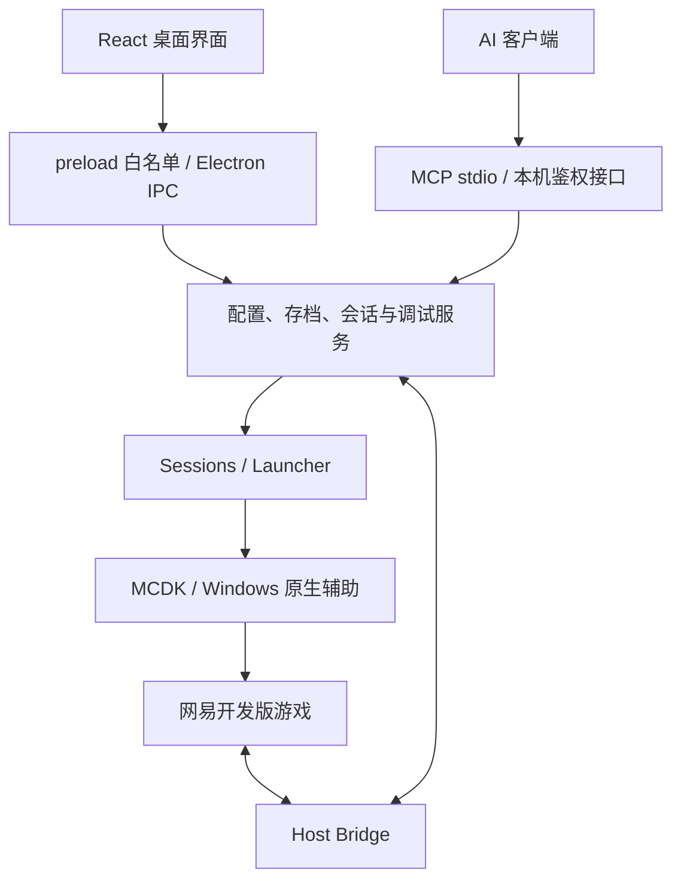

# 架构说明

[返回项目首页](../README.md) · [使用指南](使用指南.md) · [开发指南](开发指南.md)

本页描述当前源码的模块关系。文件路径以仓库根目录为基准；依赖版本以 `DesktopUI/package.json` 和锁文件为准。

## 运行结构

应用入口是构建后的 `DesktopUI/dist/main.cjs`。Electron 主进程组装服务，React 页面通过 `window.toolkit.call` 请求操作。AI 经独立 stdio 进程和回环 HTTP 鉴权接口进入相同的业务服务，不依赖界面当前选中的客户端。

游戏程序及编辑器引擎是外部安装的进程；工具箱不包含游戏完整源码。仓库中的 C# 是网络助手，不是独立业务后端。游戏模组的 Python 2.7 运行在游戏中，不是构建 React/Electron 所需的桌面 Python。

## 代码地图

| 位置 | 职责 |
|---|---|
| `DesktopUI/src/app/`、`DesktopUI/src/features/` | 页面导航、用户交互、草稿与确认 |
| `DesktopUI/shared/` | renderer、Electron 与测试共用的纯逻辑模型和解析器 |
| `DesktopUI/src/app/ui.jsx` | 公共控件；新页面优先复用 |
| `DesktopUI/electron/main.cjs`、`preload.cjs` | 应用装配、窗口、IPC 与界面权限 |
| `DesktopUI/electron/services.cjs` | WorkspaceStore 配置读写、Launcher 单会话启动和日志 |
| `DesktopUI/electron/domains/profiles/` | 配置库、全局模组库和引用关系 |
| `DesktopUI/electron/domains/worlds/` | 存档索引、导入、自带包、回收恢复与运行保护 |
| `DesktopUI/electron/sessions.cjs`、`domains/reload/` | 多会话、启动快照、快速测试、来源检查与定向重启 |
| `DesktopUI/electron/host-isolation.cjs`、`isolation-*.cjs` | 独立主机环境、启动桥与进程组 |
| `DesktopUI/electron/debug/` | Host Bridge、代码执行、脚本更新、UI Inspector、性能采样 |
| `DesktopUI/electron/domains/game/` | 游戏发现、进程、日志、历史和选项处理 |
| `DesktopUI/electron/domains/automation/` | MCP schema、路由、本机鉴权、目标 MCDK 工具转发 |
| `DesktopUI/electron/domains/client/` | 本机客机启动、OreUI 房间识别、入房与回执 |
| `DesktopUI/electron/network/` | 网络组件、邀请协议、远程房间、重连与 Python 文件同步 |
| `DesktopUI/electron/domains/editor/` | UI 文档保存、官方编辑器引擎预览与窗口管理 |
| `DesktopUI/electron/domains/performance/` | Tracy 性能窗口和采样生命周期 |
| `DesktopUI/native/` | 自有原生源码、MinHook、网络助手与布局内核 |
| `DesktopUI/runtime/` | MCDK、必要原生二进制及构建生成的运行辅助文件 |
| `DesktopUI/scripts/`、`DesktopUI/tests/` | 构建、出包、回归测试和夹具 |

第三方调试模块的移植边界见 [SOURCES.md](../DesktopUI/electron/debug/vendor/SOURCES.md)，许可证见 [NOTICE.md](../licenses/NOTICE.md)。

## 启动与配置

1. 入口提交明确的配置 ID、worldId 或快速测试选择。
2. Sessions 检查目录、EXE、配置 revision、存档状态和冲突。
3. 合并已保存配置、全局设置与存档选项，生成本次运行快照。
4. 准备自带模组；对支持组合申请独立主机环境和存档锁。
5. Launcher 启动 MCDK，MCDK 再启动游戏；每个会话保留其所属进程。
6. Host Bridge 报告连接和游戏就绪状态，日志与调试操作路由至对应会话。

必须区分界面草稿、已保存模板、运行快照和真实存档。改变配置只影响后续启动；本机自动加入的客机继承房主本次快照，远程邀请客机使用自己的全局设置和原生包下载流程。

快速测试只保存勾选的模组 ID 并生成本次运行快照，不向配置库新增模板。源码内容修改可以走热更新；目录、启用顺序或热更新配置变更时，工具箱重载入口检查来源并要求按最新配置重启。重启前由使用者保存进度，软件不额外自动保存。

## 数据位置

| 数据 | 默认位置或归属 |
|---|---|
| 设置、配置、模组登记 | `%LocalAppData%/DaGuoNeko_GameToolkit/`，包括 `settings.json`、`profiles/`、`mods.json` |
| 运行快照、日志、报告、MCP 登记 | 上述目录中的 `runs/`、`logs/`、`debug-reports/`、`mcp/` |
| 存档索引及托管入口 | `%AppData%/MinecraftPE_Netease/minecraftWorlds/DaGuoNekoGameToolkit/` |
| 原目录模式的真实存档 | 用户登记的原目录，游戏进度直接写回 |
| 地图自带包 | 首次启动时可能迁至实际存档的 `.toolbox-packs/`，该目录长期保留 |
| 独立主机环境 | `%UserProfile%/DgnGameToolkitHosts/` |
| 源码、工具链、构建产物 | 见[开发指南的目录规则](开发指南.md#目录用途与版本控制) |

工具箱配置主要使用 JSON/JSONC 文件；游戏的 `db/` 是世界数据库，不按文本编辑。原目录模式移除登记只解除入口，不删除原世界。独立主机隔离部署和缓存，不复制模组源码；多个会话引用同一源码目录仍会共享修改。

## 进程、权限和协议边界

- 渲染器保持 `sandbox`、`contextIsolation`，不启用 Node.js；功能经 preload 白名单和主进程校验。
- 进程归属结合 registrationId、父 PID、游戏 PID、规范 EXE 路径和句柄，不按进程名批量停止游戏。
- 原生隔离通过 Windows Job、受控 junction 和 Known Folder 重定向管理新建进程；不得绕过同存档互斥、LevelDB LOCK 或游戏哈希校验。
- MCP 使用明确的 sessionId/generation。超时且结果不明时先读状态，不自动重复执行有副作用的操作。
- 房间身份和加入草稿由 Electron safeStorage 在当前 Windows 用户下保护，不放入公开状态或日志。
- 临时测试环境变量会改变数据位置和部分检查分支，不能当成完整实机沙箱，详见[开发指南](开发指南.md#开发启动与测试隔离)。

## 当前能力边界

独立存档主机仅对已核验的内置 MCDK v1.6.1 与游戏 3.10.0.436581 组合启用；原生自动入房已适配 3.10.0.420447 和 3.10.0.436581。引擎登记见 `DesktopUI/electron/supported-engines.json`，不能只修改版本显示就扩展支持。

本机多人测试使用存档房主和 `launch_joined_client`；“联机房间”用于远程分享。远程同步主要覆盖已有 Python 文件，不包含 UI JSON、模型、贴图或初始化重跑，异地两机效果仍需独立验收。

[UI 编辑器](UI_EDITOR_STATUS.md) 的本地 Canvas/WASM 预览只实现部分布局语义；[官方引擎预览](EDITOR_ENGINE.md) 是外部引擎进程，二者都不能直接证明全部业务模组可运行。
